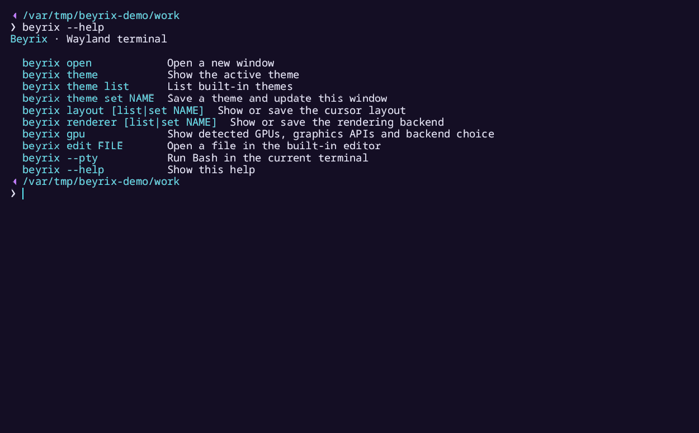
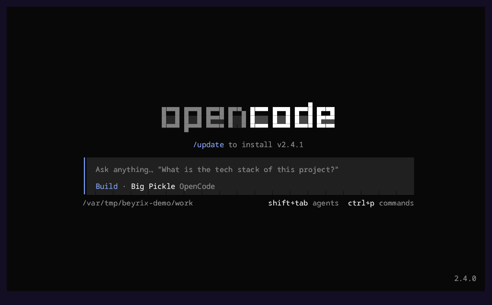
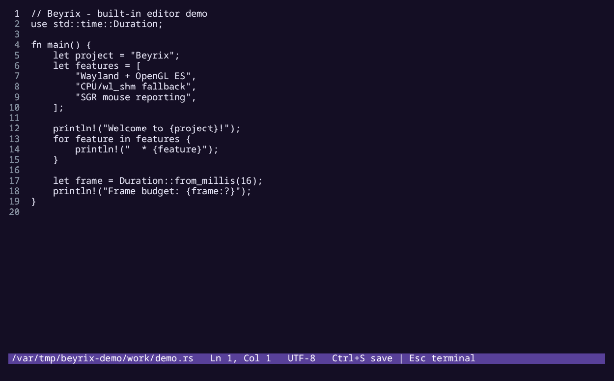
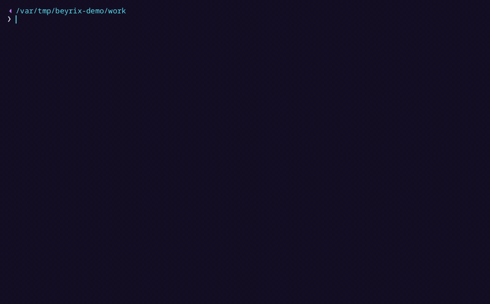

# Beyrix

**Beyrix** is an experimental, open-source terminal emulator written in Rust for **Linux/Wayland**. It combines a native Wayland window, an OpenGL ES renderer with a software fallback, a PTY-backed Bash session, a built-in text editor, and terminal-first features such as scrollback, selection, clipboard integration and SGR mouse reporting.

[](https://github.com/Beykus-Y/Beyrix/actions/workflows/ci.yml)
[](https://github.com/Beykus-Y/Beyrix/releases)
[](LICENSE)

> **Status: first alpha (`v0.1.0-alpha.1`).** Expect bugs and breaking changes. Beyrix does not claim full xterm/VT compatibility, a Vulkan renderer, or support for Windows, macOS, X11 or ARM64.



## Features

These features exist in the current code and are exercised by the test suite or by the release smoke tests below.

- **Native Wayland window** built on `xdg-shell`, with fractional scaling through `wp_fractional_scale_v1` and `wp_viewporter` when the compositor advertises them.
- **OpenGL ES 2.0 rendering** through EGL (`glow` + `khronos-egl`) and a **CPU/`wl_shm` software renderer**. `auto` selects OpenGL only when a real hardware context is available; `llvmpipe`, `softpipe` and `swrast` fall back to software. A failed OpenGL context never leaves a black window.
- **PTY-backed interactive Bash** (`/bin/bash -i`) with resize handling.
- **Terminal state and escape sequences** through `vte`: alternate screen, cursor save/restore, 16/256/truecolor SGR, reverse video, bracketed paste, cursor shapes and terminal status reports.
- **Scrollback** with configurable limits (up to 100,000 lines and a 64 MiB history payload cap), wheel and Shift+PageUp/PageDown navigation.
- **Selection and clipboard**: mouse selection, double-click word selection, triple-click logical-line selection, drag scrolling, Ctrl+C/Ctrl+V with Wayland clipboard and bracketed paste.
- **SGR mouse reporting** for TUI applications, including button, wheel, motion, modifier bits and legacy X10 encoding.
- **Three cursor layouts**: `as-is`, `bottom` and `bottom-input`.
- **Built-in editor** (`beyrix edit FILE`) with UTF-8/BOM/CRLF handling, undo/redo, clipboard, word navigation, atomic saves, permission preservation and conflict warnings.
- **Themes and prompt integration**: built-in `minimal`, `developer` and `signature` themes, Git-aware Bash prompts, live theme updates through a local control socket.
- **Customization** of font size, padding, colors, cursor shape/blink, scrolling and renderer through TOML configuration.
- **CLI tools**: theme/layout/renderer selection, `beyrix gpu` diagnostics, `beyrix edit`, and `beyrix --pty`.
- **MPL-2.0 licensed** source code.

OpenCode running inside Beyrix:



Built-in editor:



Short demonstration of live theme switching:



All screenshots and the GIF are real captures of the release build running under Wayland (Niri 26.04, 1920×1080, scale 1.25, AMD Radeon integrated GPU). No generated mock-ups are used.

## Requirements

### Supported platform

- **Linux x86_64** with a working **Wayland** session. Official archives are built on Ubuntu 24.04 and require glibc 2.39 or newer (for example Ubuntu 24.04+, Fedora 40+, Debian 13+).
- A compositor that provides `xdg-shell`, `wl_shm`, `wl_seat` and `wl_data_device_manager`. Tested primarily on Niri; other standard Wayland compositors are expected to work but have not all been verified.
- **Bash** at `/bin/bash` for the interactive session.
- Runtime libraries: `libwayland-client`, `libxkbcommon`, **fontconfig** (`fc-match`) and at least one installed monospace font.
- Optional for hardware rendering: `libEGL` plus a working OpenGL ES driver (Mesa on AMD/Intel, proprietary or Mesa on NVIDIA). Without them Beyrix uses the software renderer.

### Not supported yet

- X11-only sessions, Windows, macOS and ARM64 are **not** supported by this release. No binaries or compatibility claims exist for those platforms.
- Vulkan device discovery is implemented, but there is **no Vulkan renderer**. Selecting `vulkan` falls back to software.

## Install on Fedora (COPR)

Beyrix is packaged for Fedora 44 and 45 on x86_64 in the
[beykus-y/beyrix](https://copr.fedorainfracloud.org/coprs/beykus-y/beyrix/) COPR
project. The package is built from the tagged source with locked, vendored
dependencies and is installed and updated through DNF:

```sh
sudo dnf copr enable beykus-y/beyrix
sudo dnf install beyrix
```

Then start it from a Wayland session:

```sh
beyrix
```

The package installs the `beyrix` binary, a desktop entry, AppStream metadata, a
manual page and the license information for the bundled crates. See
[packaging/fedora/README.md](packaging/fedora/README.md) for build, packaging and
release details.

## Install from GitHub Releases

Download the Linux x86_64 archive and checksums, verify them, then install the binary into your user path:

```sh
VERSION=v0.1.0-alpha.1
BASE="https://github.com/Beykus-Y/Beyrix/releases/download/$VERSION"

curl -LO "$BASE/beyrix-$VERSION-linux-x86_64.tar.gz"
curl -LO "$BASE/SHA256SUMS"
sha256sum -c SHA256SUMS --ignore-missing

tar -xzf "beyrix-$VERSION-linux-x86_64.tar.gz"
cd "beyrix-$VERSION-linux-x86_64"
./install.sh          # installs to ~/.local/bin, or use PREFIX=/usr/local
```

If `~/.local/bin` is not in your `PATH`, add it to your shell profile. You can also install manually:

```sh
install -Dm755 beyrix ~/.local/bin/beyrix
```

Then start Beyrix from a Wayland session:

```sh
beyrix
```

The archive contains the `beyrix` executable, `LICENSE`, `README.md`, the English and Russian configuration guides, the architecture overview, `install.sh` and `BUILD-INFO.txt` with the source commit and build toolchain. The binary is dynamically linked against the system libc and `libxkbcommon`; the Wayland and EGL libraries are loaded at runtime. It is not a fully static or universal binary.

## Build from source

You need a recent stable Rust toolchain (edition 2024), `cargo`, a C toolchain, `pkg-config` and the Wayland/XKB development headers. On Fedora:

```sh
sudo dnf install gcc make pkgconf-pkg-config wayland-devel libxkbcommon-devel fontconfig
```

On Debian/Ubuntu:

```sh
sudo apt install build-essential pkg-config libwayland-dev libxkbcommon-dev libfontconfig1-dev
```

Then:

```sh
git clone https://github.com/Beykus-Y/Beyrix.git
cd Beyrix
cargo build --release --locked
./target/release/beyrix --help
./target/release/beyrix
```

A small helper script is included:

```sh
./build.sh          # format check, cargo check, debug build
./build.sh release  # release build
./build.sh run      # run from source
```

### Reproduce the release checks

```sh
cargo fmt --all -- --check
cargo clippy --all-targets --all-features -- -D warnings
cargo test --all-targets
cargo build --release --locked
./scripts/package-release.sh v0.1.0-alpha.1
```

The graphical tests and the application itself require an active Wayland session. Unit tests do not replace a real compositor smoke test.

## CLI examples

```sh
beyrix                     # open a new window
beyrix --help              # show all commands
beyrix --pty               # run Bash in the current terminal, without a window
beyrix theme list          # minimal, developer, signature
beyrix theme set signature # save a theme and update the running window
beyrix layout list         # as-is, bottom, bottom-input
beyrix layout set bottom-input
beyrix renderer list       # auto, opengl, vulkan, software
beyrix renderer set software
beyrix gpu                 # DRM/EGL/Vulkan diagnostics and backend decision
beyrix edit notes.md       # open a file in the built-in editor
```

Configuration lives in `$XDG_CONFIG_HOME/beyrix/config.toml` (usually `~/.config/beyrix/config.toml`). See [CONFIGURATION.en.md](CONFIGURATION.en.md) for the English reference or [CONFIGURATION.md](CONFIGURATION.md) for the original Russian documentation.

### Upgrading from Beynal

The application, Cargo package and executable are now **Beyrix** (`beyrix`). Existing `~/.config/beynal/config.toml` is copied once to `~/.config/beyrix/config.toml` if the new file does not exist. No existing file is deleted or overwritten, and existing Beyrix settings always take priority. If the copy fails, Beyrix keeps reading the old file without modifying it. See [CONFIGURATION.en.md](CONFIGURATION.en.md) for details.

If you already installed a `beynal` binary system-wide, update any shell aliases or launchers to `beyrix` when installing the new version.

## Known limitations

- **Alpha quality.** The terminal parser is not a complete xterm/VT implementation. Some applications may render incorrectly or use unsupported escape sequences. Please report a minimal reproducer.
- **Wayland/Linux x86_64 only.** There is no X11 backend, no Windows/macOS port and no ARM64 release.
- **No Vulkan renderer.** Vulkan devices are detected for diagnostics only; the `vulkan` renderer option falls back to software.
- **One session per window.** Tabs, split panes and multiple terminal sessions in one window do not exist yet.
- **No keyboard autorepeat handling** from the compositor in the graphical window. Typing works, but holding a key does not repeat inside Beyrix.
- **Editor scope.** One file at a time, no tabs, no syntax highlighting and no LSP. Unsaved changes require confirmation before closing.
- **`bottom-input` edge case.** Asynchronous output written while a line is being edited can still overwrite the input line, because the PTY uses standard terminal semantics.
- **Hardware acceleration is optional.** GPU selection depends on the compositor, EGL and driver. Software rendering is the guaranteed fallback and can use more CPU on large windows.
- **Not security-audited.** Beyrix executes shell programs and handles terminal escape sequences and clipboard data. Treat it as experimental software.

## Documentation

- [Configuration reference (English)](CONFIGURATION.en.md)
- [Конфигурация (русский)](CONFIGURATION.md)
- [Architecture overview](docs/ARCHITECTURE.md)
- [Contributing guide](CONTRIBUTING.md)
- [Roadmap](ROADMAP.md)
- [Security policy](SECURITY.md)
- [Code of Conduct](CODE_OF_CONDUCT.md)
- [Release notes](docs/releases/v0.1.0-alpha.1.md)
- [Fedora/COPR packaging](packaging/fedora/README.md)

## Contributing and helping the project

Contributions, bug reports, compatibility findings, documentation and packaging work are welcome.

- Read [CONTRIBUTING.md](CONTRIBUTING.md) and the [architecture overview](docs/ARCHITECTURE.md) before submitting a change.
- Use [GitHub Discussions](https://github.com/Beykus-Y/Beyrix/discussions) for questions, ideas and show-and-tell; use [Issues](https://github.com/Beykus-Y/Beyrix/issues) for reproducible bugs and scoped feature requests.
- See the [roadmap](ROADMAP.md) for current priorities.
- Follow [CODE_OF_CONDUCT.md](CODE_OF_CONDUCT.md) in all project spaces.

You do not need to write Rust to help:

- Test Beyrix with your compositor, terminal programs (shells, editors, `git`, `ssh`, TUI tools) and report escape-sequence incompatibilities.
- Test the OpenGL and software backends on different GPUs and distributions.
- Improve the English documentation, screenshots, packaging or CI.
- Reproduce bugs with exact commands and remove tokens, private paths and other sensitive data from reports.

## License

Beyrix is licensed under the **Mozilla Public License 2.0 (MPL-2.0)**. See [LICENSE](LICENSE). Modified MPL-covered files must remain available in source form when distributed under the license terms; using the project privately does not oblige you to publish changes. No license requires contributors to send pull requests upstream.

This project is not affiliated with Ghostty, Alacritty, OpenCode or other terminal emulators.